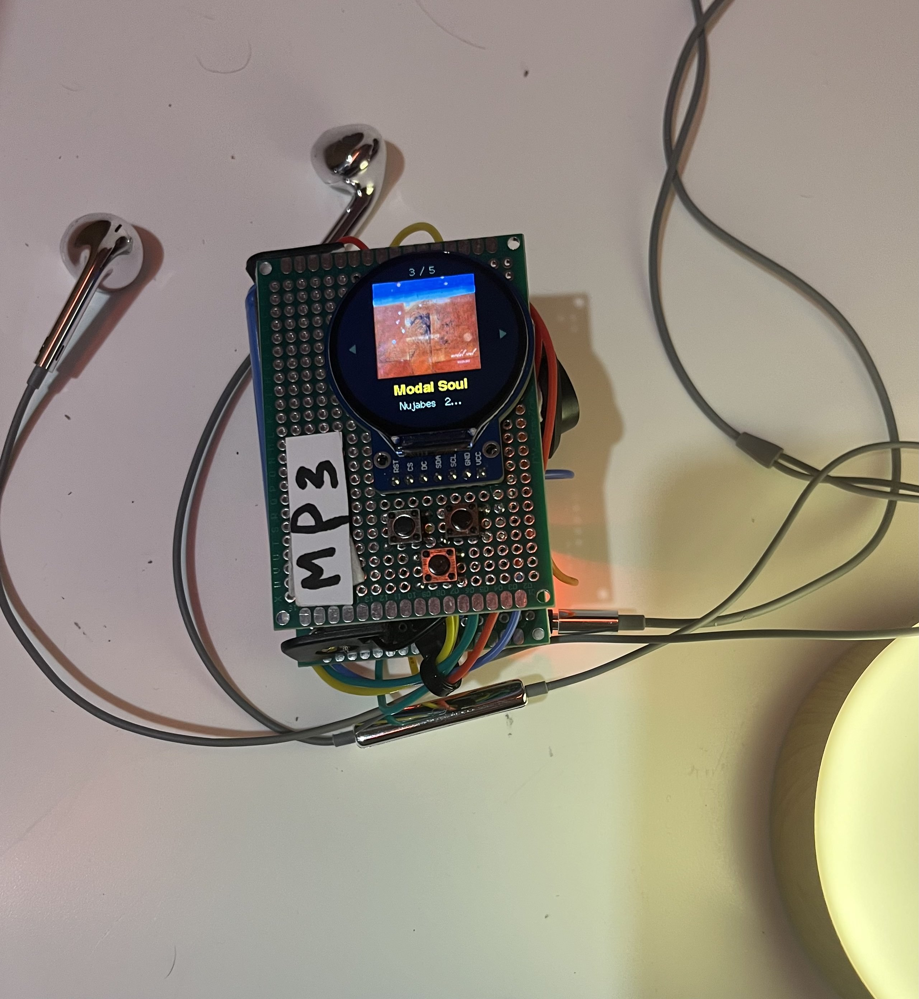
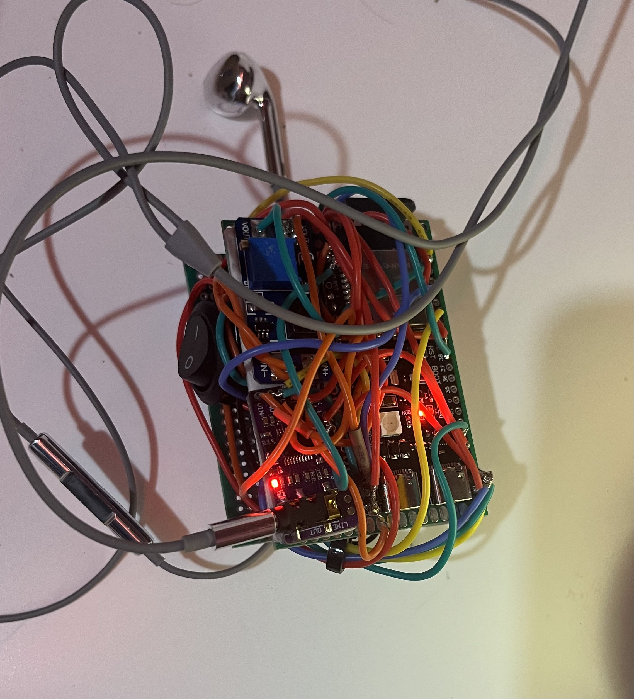

# open-mp3

> A fun open-source mp3 player anyone can build themselves!!
<p align="center">
  
  
</p>

## Why

> Made it as a cool side project during uni. And to learn more about electronics!

## Parts

| Part | Notes |
|---|---|
| ESP32-S3-DevKitC-1 **N16R8** | 16 MB flash, 8 MB PSRAM (the PSRAM holds the screen buffer and cover art) |
| PCM5102A I2S DAC module (GY-PCM5102) | stereo line out on a 3.5 mm jack |
| 1.28" round 240×240 display, GC9A01 | SPI; the backlight is always on |
| SPI microSD card module | FAT32 card; a 32 GB card holds roughly 150 albums |
| 3 push buttons | each wired from a GPIO to GND (internal pull-ups) |
| 1-cell LiPo battery | 3.7 V |
| TP4056 USB-C charging board **with protection** (DW01A, has OUT+/OUT− pads) | charges the LiPo and cuts it off on over-discharge, overcharge or short |
| 5 V boost converter | boost output to the board's 5V pin |
| Perfboard, hookup wire, headphones | |

>  Cost about £30 altogether, a mix of amazon/ali-express parts and old scrap. I would recommend just pasting in part names to ali-express!

## Wiring

**PCM5102A DAC**

| DAC pin | ESP32-S3 |
|---|---|
| VIN | 3V3 |
| GND | GND |
| BCK | GPIO 9 |
| LRCK | GPIO 10 |
| DIN | GPIO 11 |
| SCK | GND (no master clock) |
| FLT | GND |
| DEMP | GND |
| XSMT | 3V3 (unmuted) |
| FMT | GND |

**Power**
```
LiPo ── B+/B− [TP4056] OUT+/OUT− ── boost converter ── 5V pin
```
| From | To |
|---|---|
| LiPo + / − | TP4056 B+ / B− |
| TP4056 OUT+ / OUT− | boost converter IN+ / IN− |
| boost converter OUT+ | ESP32-S3 5V |
| boost converter OUT− | GND |
Charge through the TP4056's USB-C port.

**GC9A01 display** (on its own SPI bus)

| Display pin | ESP32-S3 |
|---|---|
| VCC | 3V3 |
| GND | GND |
| SCL (SPI clock) | GPIO 17 |
| SDA (SPI data) | GPIO 18 |
| DC | GPIO 39 |
| CS | GPIO 21 |
| RST | GPIO 40 |

The display's "SDA/SCL" labels are SPI, not I2C.

**microSD module** (on its own SPI bus)

| SD pin | ESP32-S3 |
|---|---|
| CS | GPIO 12 |
| SCK | GPIO 13 |
| MOSI | GPIO 38 |
| MISO | GPIO 15 |
| VCC | 5V if the module has a regulator, 3V3 if it's a bare breakout |
| GND | GND |

**Buttons** (each to GND)

| Button | GPIO |
|---|---|
| Play / pause / select | 47 |
| Next / down / volume up | 1 |
| Previous / up / volume down | 42 |
| View switch | 0 (the board's BOOT button) |

**Reserved:** GPIO 4 for battery voltage sensing (not used yet).

**Don't use** GPIO 35–37 (wired to the PSRAM on N16R8 boards), 45 and 46 (boot strapping pins), 19–20 (USB) or 43–44 (serial).

> I would recommend using a perfboard but I am not one to talk to about cable management xD

## Controls

| | Album covers | Track list | Now playing |
|---|---|---|---|
| **GPIO 47** press | open album | play track | pause / play |
| **GPIO 47** hold | back to now playing | back to albums | track list |
| **GPIO 1** | next album | down | next track; hold for volume up |
| **GPIO 42** | previous album | up | previous track (restarts the track if more than 3 s in); hold for volume down |
| **BOOT** | go to now playing | go to now playing | switch cover view / countdown dial |

**Other behaviour:**
- Playback runs on into the next album.
- After 15 s idle in the menus, the screen returns to now playing.
- The volume (12 steps) and the chosen view are remembered when the power is off.

## Flashing the firmware

Install:
- **Arduino IDE** or `arduino-cli`
- **ESP32 Arduino core 2.0.17** (tested; core 3.x is untested)
- **LovyanGFX** (tested with 1.2.32)

Board settings:
- Board: **ESP32S3 Dev Module**
- Flash size: **16MB**
- PSRAM: **OPI PSRAM**

Open `firmware/open_mp3/open_mp3.ino` and upload over the board's **COM** USB port.

With arduino-cli:

```
arduino-cli compile --fqbn "esp32:esp32:esp32s3:FlashSize=16M,PSRAM=opi" --upload -p <port> firmware/open_mp3
```

## Adding music

Needs Python 3, `ffmpeg` and `pyserial`.

1. Copy `tools/albums.example.json` to `tools/albums.json`. For each album, fill in the
   folder, title, artist, year, cover image and the track list in order. Any format ffmpeg
   reads works (MP3, FLAC, ...).
2. Convert:

   ```
   python3 tools/prepare_sd.py tools/albums.json --adpcm --out sdcard
   ```

3. Copy to the card, either:
   - **over USB** (no card reader; about 240 KB/s, so roughly 7 minutes per album):

     ```
     python3 tools/upload_music.py sdcard/music
     ```

     Albums already on the card are skipped, and every file is checksummed.
   - **with a card reader:** copy `sdcard/music` to the root of the card. Without
     `--adpcm` you get full 16-bit stereo, at 4× the size.

**What's on the card:** one folder per album, `/music/<year> <title>/`, each holding
`album.txt`, the cover art and `01.wav`, `02.wav`, ... Albums sort by year.


## What's next

> Battery gauge, a custom PCB, and maybe even a shuffle option!!

## License

> MIT 
